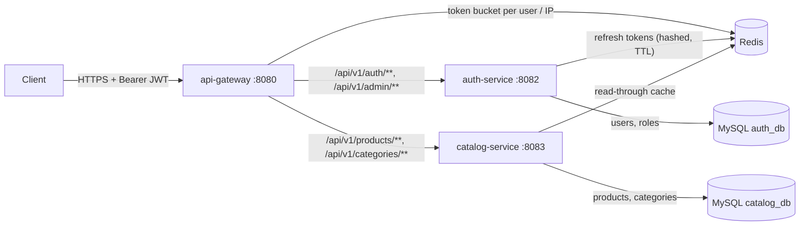

# Secure API Gateway and Microservices Platform


A **Spring Cloud Gateway** in front of two **Spring Boot** microservices, built to show how a production API edge is secured. The gateway validates every **JWT** and applies **role-based access control (RBAC)**. It also applies **Redis-backed rate limiting** and adds a request id for tracing. Behind it, an **auth service** issues short-lived access tokens and **rotating refresh tokens**, and a **catalogue service** serves product data from **MySQL** with a **Redis read-through cache**. Each service checks the token and roles again itself, so the gateway is not a single point of trust.

**Stack:** Java 21 · Spring Boot 3.4 · Spring Cloud Gateway 2024.0 · Spring Security (OAuth2 resource server, JWT, BCrypt) · Spring Data JPA / Hibernate · MySQL 8.4 · Flyway · Redis 7 · JUnit 5 · Mockito · Testcontainers · Micrometer / Prometheus · Docker Compose · GitHub Actions

---

## Architecture



```mermaid
sequenceDiagram
    participant Client
    participant Gateway as api-gateway
    participant Auth as auth-service
    participant Catalog as catalog-service
    Client->>Gateway: POST /api/v1/auth/login
    Gateway->>Gateway: rate limit per IP (5/s, burst 10)
    Gateway->>Auth: forward
    Auth->>Auth: BCrypt check, sign JWT (15 min), store refresh token hash in Redis (7 days)
    Auth-->>Client: accessToken + refreshToken
    Client->>Gateway: GET /api/v1/products/1 (Bearer JWT)
    Gateway->>Gateway: verify signature, expiry, issuer; ROLE_USER or ROLE_ADMIN; rate limit per user
    Gateway->>Catalog: forward with X-Request-Id
    Catalog->>Catalog: verify JWT again; Redis cache hit, or MySQL then cache
    Catalog-->>Client: product JSON
    Client->>Gateway: POST /api/v1/auth/refresh (old refresh token)
    Gateway->>Auth: forward
    Auth->>Auth: GETDEL old token (single use), issue new pair
    Auth-->>Client: new accessToken + new refreshToken
```

## Design decisions

| Problem | Solution in this project |
|---|---|
| Every service re-implementing auth checks | **Gateway as the policy enforcement point.** JWT signature, expiry and issuer are validated once at the edge, and role rules per route (`USER` reads, `ADMIN` writes, `/admin/**` admin only) reject bad requests before any downstream call. Unknown paths are denied by default. |
| A request that bypasses the gateway | **Defence in depth.** Each service is its own OAuth2 resource server with the same RBAC rules; auth-service also uses `@PreAuthorize` on its admin service. Only the gateway port is published in Docker Compose. |
| Long-lived tokens can't be revoked | **Short access tokens (15 min) and opaque refresh tokens (7 days).** Refresh tokens are stored in Redis as SHA-256 hashes with a TTL. Logout deletes them. |
| A stolen refresh token | **Refresh-token rotation.** Each refresh consumes the token with Redis `GETDEL` (atomic, single use) and issues a new pair. A replayed token gets 401. |
| Password storage | **BCrypt (cost 12).** Passwords over 72 bytes are refused rather than silently truncated. Wrong password and unknown user return the same message, so usernames can't be probed. |
| Brute force and noisy clients | **Redis token-bucket rate limiting** (`RedisRateLimiter`, a Lua script, so the limit holds across gateway replicas). A strict per-IP limit applies to login, register and refresh, and a per-user limit to the API. Over the limit, the client gets `429` with `X-RateLimit-*` headers. |
| Header spoofing | The gateway strips `X-User-Id` / `X-User-Roles` from client requests, and only accepts a well-formed `X-Request-Id`. |
| Read-heavy catalogue | **Redis read-through cache** (`@Cacheable`) for single products and the category list, with a typed JSON serializer per cache. `@CachePut` on update and `@CacheEvict` on delete keep the cache consistent with writes made through the API. Paged lists are not cached (too many key combinations). |
| Query performance | **Normalised MySQL schema** (users / roles / user_roles; categories / products) with composite indexes matching the real queries: `(active, category_id, name)` for category listings and `(active, name)` for prefix search. The prefix search avoids `UPPER()` so the index stays usable, because the default collation is already case-insensitive. `@EntityGraph` avoids N+1 queries. |
| Lost updates | JPA `@Version` **optimistic locking**; a conflicting update returns `409`. |
| Schema changes | **Flyway** migrations, with Hibernate set to `ddl-auto: none`. |
| Tracing a request across services | `RequestIdFilter` sets `X-Request-Id` on the forwarded request and the response, and logs method, path, status and latency. |
| Errors | RFC 9457 **problem details** (`application/problem+json`) with field-level validation errors. |

## Run it locally

Requirements: Docker Desktop (Compose v2). Java 21 and Maven are only needed to run the tests outside Docker.

```bash
docker compose up --build
```

Everything goes through the gateway on **http://localhost:8080**. Docker Compose creates a demo admin account (`admin` / `Admin-pass-123`). Override it with `ADMIN_PASSWORD`.

### Try it

```bash
# Register a normal user and log in
curl -s -X POST localhost:8080/api/v1/auth/register -H 'Content-Type: application/json' \
  -d '{"username":"alice","email":"alice@example.com","password":"alice-password"}'

LOGIN=$(curl -s -X POST localhost:8080/api/v1/auth/login -H 'Content-Type: application/json' \
  -d '{"username":"alice","password":"alice-password"}')
TOKEN=$(echo "$LOGIN" | jq -r .accessToken)
REFRESH=$(echo "$LOGIN" | jq -r .refreshToken)

# USER can read the catalogue (the second call is served from Redis)
curl -s localhost:8080/api/v1/products?categoryId=1 -H "Authorization: Bearer $TOKEN" | jq
curl -s localhost:8080/api/v1/products/1 -H "Authorization: Bearer $TOKEN" | jq

# ...but can't write to it: 403 from the gateway
curl -s -o /dev/null -w '%{http_code}\n' -X POST localhost:8080/api/v1/products \
  -H "Authorization: Bearer $TOKEN" -H 'Content-Type: application/json' -d '{}'

# ADMIN can
ADMIN=$(curl -s -X POST localhost:8080/api/v1/auth/login -H 'Content-Type: application/json' \
  -d '{"username":"admin","password":"Admin-pass-123"}' | jq -r .accessToken)
curl -s -X POST localhost:8080/api/v1/products -H "Authorization: Bearer $ADMIN" -H 'Content-Type: application/json' \
  -d '{"sku":"ELEC-0003","name":"Mechanical Keyboard","price":89.00,"stockQuantity":10,"categoryId":1}' | jq

# Refresh-token rotation: the first refresh works, replaying the same token gives 401
curl -s -X POST localhost:8080/api/v1/auth/refresh -H 'Content-Type: application/json' -d "{\"refreshToken\":\"$REFRESH\"}" | jq
curl -s -o /dev/null -w '%{http_code}\n' -X POST localhost:8080/api/v1/auth/refresh \
  -H 'Content-Type: application/json' -d "{\"refreshToken\":\"$REFRESH\"}"

# Rate limiting: hammer login and watch 429s appear
for i in $(seq 1 20); do curl -s -o /dev/null -w '%{http_code} ' -X POST localhost:8080/api/v1/auth/login \
  -H 'Content-Type: application/json' -d '{"username":"alice","password":"wrong"}'; done; echo
```

## API

| Method | Path (via gateway) | Access | Notes |
|---|---|---|---|
| POST | `/api/v1/auth/register` | public | New accounts get `USER` |
| POST | `/api/v1/auth/login` | public | Returns `accessToken`, `refreshToken`, `expiresIn` |
| POST | `/api/v1/auth/refresh` | public (needs refresh token) | Rotates the refresh token |
| POST | `/api/v1/auth/logout` | public (needs refresh token) | Revokes the refresh token |
| GET | `/api/v1/auth/me` | signed in | Claims from the token |
| GET | `/api/v1/admin/users` | ADMIN | Paged user list |
| PUT | `/api/v1/admin/users/{id}/roles` | ADMIN | e.g. `{"roles":["USER","ADMIN"]}` |
| PUT | `/api/v1/admin/users/{id}/enabled` | ADMIN | Disable or enable an account |
| GET | `/api/v1/products?categoryId=&q=&page=&size=` | USER, ADMIN | Paged, sorted by name |
| GET | `/api/v1/products/{id}` | USER, ADMIN | Cached in Redis |
| POST / PUT / DELETE | `/api/v1/products[/{id}]` | ADMIN | Delete is a soft delete |
| GET | `/api/v1/categories` | USER, ADMIN | Cached in Redis |
| POST | `/api/v1/categories` | ADMIN | |

Each service also serves Swagger UI on its own port (`/swagger-ui.html`) when run outside Docker.

## Tests

```bash
mvn verify
```

| Test | What it proves |
|---|---|
| `AccessTokenServiceTest` | Tokens carry subject, user id and roles; expired tokens and other issuers are rejected |
| `AuthServiceTest` (Mockito) | BCrypt hashing, duplicate checks, the same error for wrong password and unknown user, refresh rotation, logout |
| `AuthControllerTest` (`@WebMvcTest`) | Request validation, problem-detail errors, `/me` needs a token |
| `ProductServiceTest` (Mockito) | Business rules: unknown category, duplicate SKU, soft delete |
| `ProductControllerTest` (`@WebMvcTest`) | RBAC: anonymous 401, USER reads, USER writes 403, ADMIN writes |
| `GatewaySecurityTest` | Missing, tampered, expired and foreign-issuer tokens 401; role rules 403; allowed requests are forwarded |
| `ClientIpTest`, `RequestIdFilterTest` | Rate-limit keys and request-id handling |
| `AuthFlowContainersIT` | **Testcontainers (MySQL + Redis):** register → login → `/me` → refresh → replay gets 401; admin API is admin only |
| `CatalogContainersIT` | **Testcontainers (MySQL + Redis):** Flyway seed data, the indexes exist, Redis cache read-through / put / evict |
| `RateLimitingContainersIT` | **Testcontainers (Redis):** a burst of login attempts from one IP gets 429 |

The `*IT` classes need Docker and run under failsafe. They are skipped automatically when Docker isn't available, and always run in GitHub Actions. JaCoCo coverage reports are written to `*/target/site/jacoco`.

## Project layout

```
api-gateway/       Spring Cloud Gateway: routes, JWT validation, RBAC, Redis rate limiting, request ids
auth-service/      Users, roles, BCrypt, JWT issuing, refresh-token rotation in Redis, admin API
catalog-service/   Products and categories on MySQL, Redis cache, RBAC
infra/mysql/       One database and user per service
docker-compose.yml MySQL, Redis and the three services; only the gateway is published
.github/workflows/ CI: build, unit + Testcontainers tests, Docker images to GHCR
```

## Production notes

- Replace the shared HS256 secret with an identity provider (Keycloak, Auth0, Cognito, Entra ID) and RS256 / JWKS: services then only hold the public key. In Spring this is one property (`issuer-uri`) instead of the custom decoders.
- Put TLS in front of the gateway, and trust `X-Forwarded-For` only from your own load balancer.
- Run Redis with replication (or ElastiCache). Rate limiting fails open if Redis is unreachable, which keeps the API up but unthrottled. Alert on that.

## License

MIT
